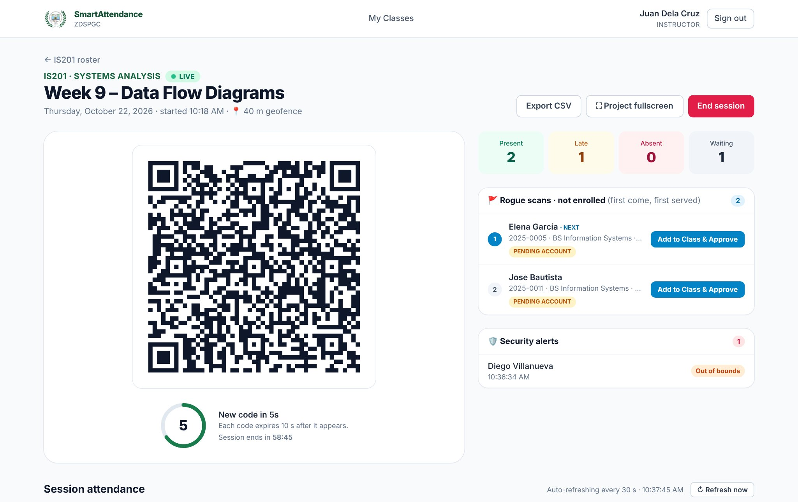
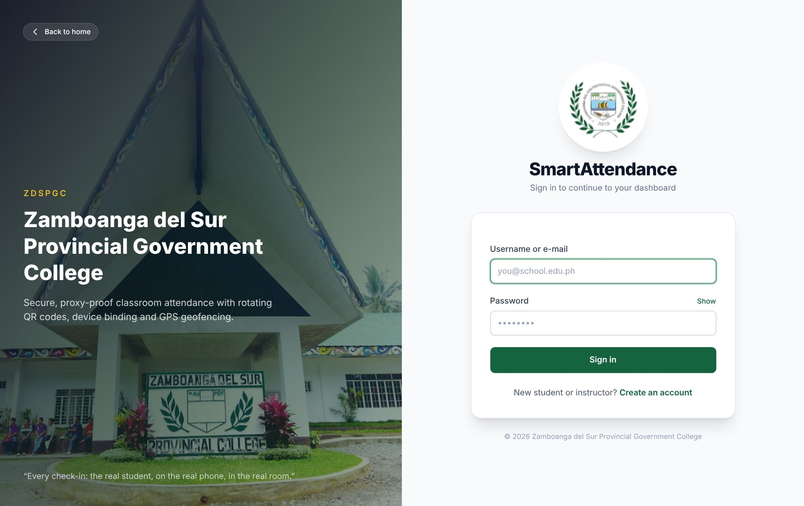
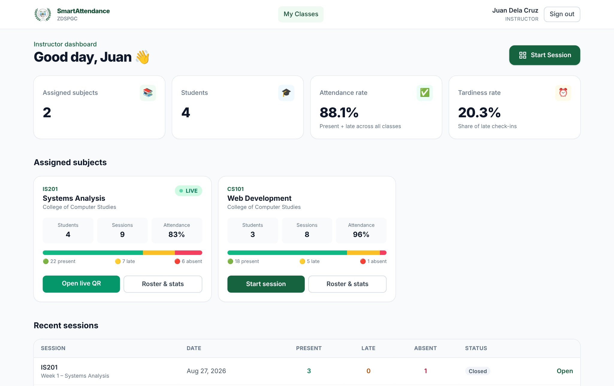
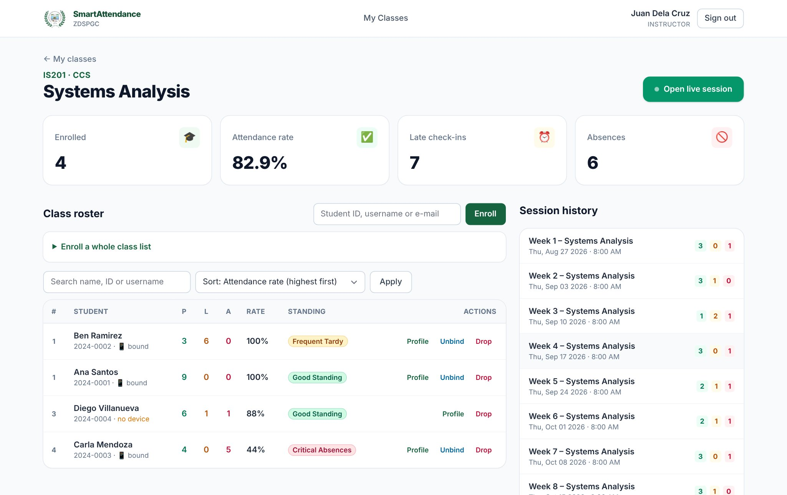
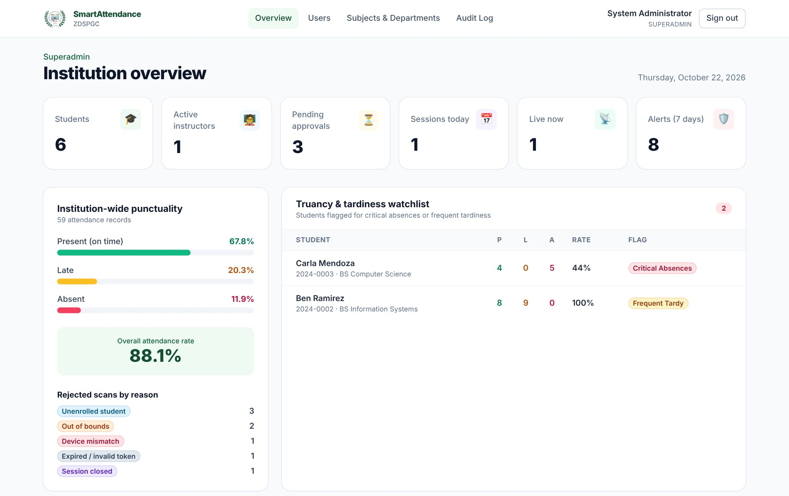
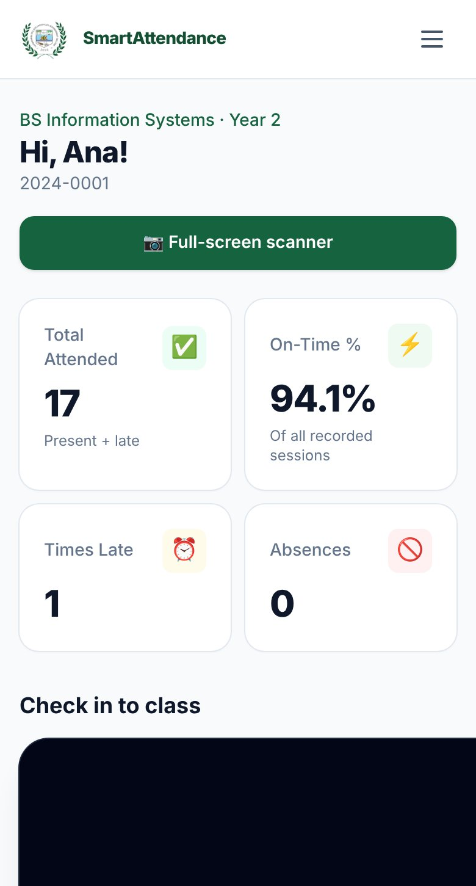
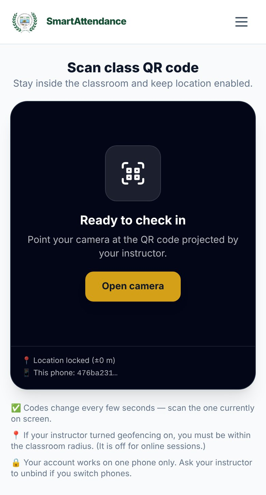
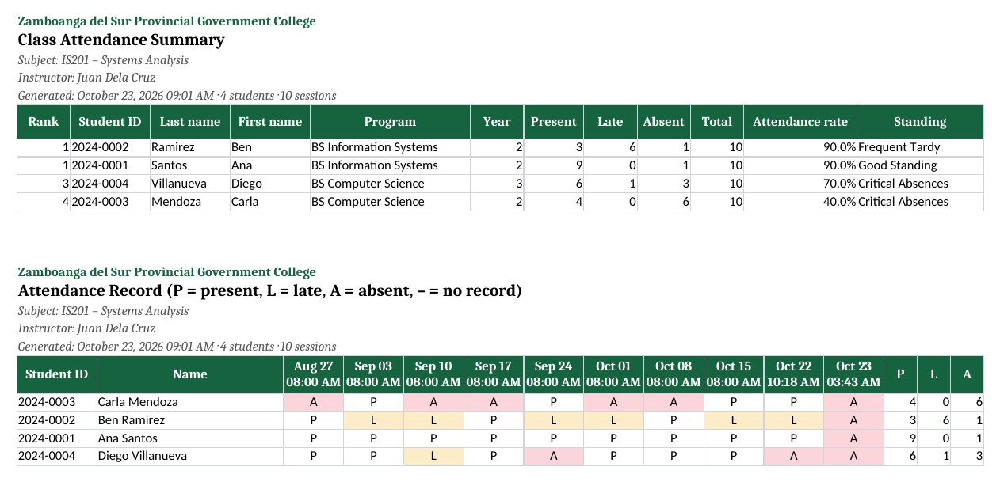
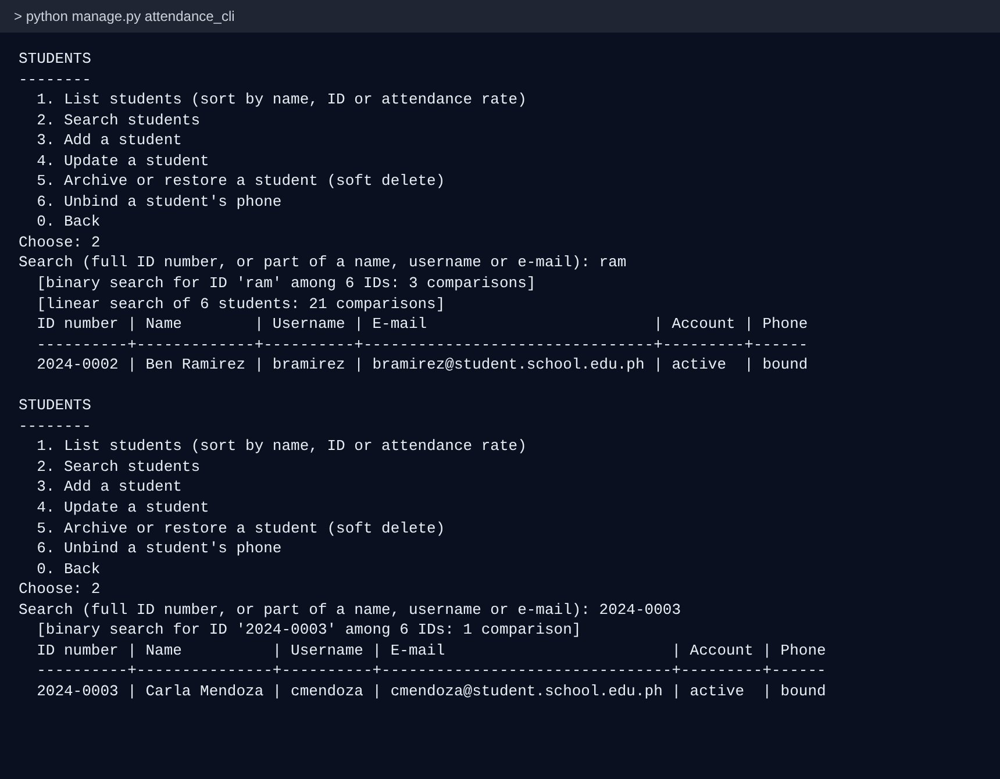

# SmartAttendance

**A web-based classroom attendance system that uses rotating QR codes, phone binding and optional geofencing to make attendance quick to take and hard to fake.**

Built for the College of Computing Studies of Zamboanga del Sur Provincial Government College (ZDSPGC), Aurora Campus, as the final project for the *Databases* and *Data Structure and Algorithm* courses of the Bachelor of Science in Information Systems.

> 📄 **Full research manuscript (55 pages):** [SmartAttendance-Manuscript.pdf](docs/SmartAttendance-Manuscript.pdf): statement of the problem, objectives, scope and limitations, ERD and data dictionary, data structures and algorithms, flowcharts, testing, screenshots and planned changes.



---

## The problem

Paper roll calls and sign-in sheets take class time and are easy to cheat: a classmate signs for an absent friend, or a photo of a static QR code gets passed around a group chat. SmartAttendance replaces them with a check-in that takes a few seconds per student and that one person cannot easily do for another.

## How a check-in works

1. The instructor starts a session. The screen shows a QR code that **changes automatically** and is valid for only a few seconds, so a photo of it soon stops working.
2. The student scans it with their phone's browser. No app to install.
3. The server checks, in order:
   1. **Token:** is the QR code genuine and still valid?
   2. **Session:** is the class session still open?
   3. **Device:** is this the student's own phone? Each account is bound to one phone, and each phone to one account.
   4. **Location** (optional for each session): is the student within the allowed distance of the instructor, measured with the Haversine formula?
   5. **Enrollment:** is the student enrolled in this subject?
4. The attendance is recorded as **present** or **late**, using a cut-off the instructor sets for each session. Every refused scan is kept in a security log with its reason.

## Features

**Instructors**
- Start a session with a duration, a late cut-off (10, 15 or 30 minutes, or custom) and geofencing on or off.
- Live roster with present, late and absent counts. Change a status or add a note inline.
- Approval queue for students who scanned but are not yet enrolled: **Add to Class & Approve** in one click.
- Class roster with search, sorting and ranking by attendance rate, bulk enrollment and a watch list of students at risk.
- Unbind a student's phone, or drop a student from the subject without deleting the account.
- Download the class record as an **Excel workbook**: summary, attendance grid and session list.

**Students**
- Phone scanner with camera and torch controls.
- Personal attendance history and punctuality cards: total attended, on-time rate, times late and absences.
- A banner while the account is awaiting verification.

**Superadministrator**
- Approve instructor sign-ups and manage accounts, subjects and departments.
- Institution-wide punctuality analytics and a truancy watch list.
- Security feed of refused scans: expired token, closed session, device mismatch, out of bounds, unenrolled student.
- Download an institution-wide **Excel report**, filtered by date range and department.

**Data safety**
- Accounts are archived (soft delete), never erased, so attendance and audit history survive.
- Role-based access: each role sees only its own pages, and instructors see only their own subjects.

## Screenshots

| Sign-in | Instructor dashboard |
|---|---|
|  |  |

| Class roster ranked by attendance | Superadministrator dashboard |
|---|---|
|  |  |

| Student dashboard | Student scanner | Excel class record |
|---|---|---|
|  |  |  |

## Tech stack

| Layer | Technology |
|---|---|
| Backend | Python 3.12+, Django 5.2, Django REST Framework |
| Database | SQLite, normalized to Third Normal Form (9 tables); PostgreSQL-ready through Django |
| QR codes | PyJWT (signed, short-lived tokens) and segno (QR generation) |
| Front end | Django templates, Tailwind CSS (compiled, no CDN), vanilla JavaScript |
| Scanner | html5-qrcode, bundled locally |
| Exports | openpyxl |
| Hosting | Tested on PythonAnywhere |

## Database design

Nine tables in three groups, all in Third Normal Form:

- **People:** `user`, `address`, `student_profile`
- **Academics:** `department`, `subject`, `subject_enrollment`
- **Attendance:** `class_session`, `attendance_log`, `audit_scan_log`

Totals such as attendance rates are calculated by counting records, never stored, so they cannot fall out of step with the data. The database itself enforces the key rules: one enrollment per student per subject, one attendance record per student per session, and one phone per student. See [docs/ERD.md](docs/ERD.md) and Section 6 of the manuscript for the full ERD and data dictionary.

## Data structures and algorithms

Written by hand in [`attendance/dsa.py`](attendance/dsa.py) and used by the application itself, not only in demonstrations:

| Structure / algorithm | Used for |
|---|---|
| **Merge sort** (stable, O(n log n)) | Ranking students by attendance rate and sorting rosters and exports |
| **Binary search** (O(log n)) | Finding a student by ID number |
| **Linear search** | Partial name matches |
| **Hash index** (dictionary) | Lookup by username or e-mail; counting statuses in one pass |
| **FIFO queue** | Approving unenrolled scans in the order they arrived |

A command-line menu lets you add, view, search, update and archive records and watch the algorithms run, with comparison counts:

```bash
python manage.py attendance_cli     # interactive menu
python manage.py dsa_benchmark      # linear vs binary search, merge sort vs built-in sort
```



## Run it locally

Requires Python 3.12 or later.

```bash
git clone https://github.com/HTMLpr0grammer/SmartAttendance.git
cd SmartAttendance
python -m venv .venv
.venv\Scripts\activate            # Windows  (macOS/Linux: source .venv/bin/activate)
pip install -r requirements.txt
python manage.py migrate
python manage.py seed_data        # demo data; prints a random password for the demo accounts
python manage.py runserver
```

Open http://127.0.0.1:8000 and sign in with a demo account listed at the end of the `seed_data` output, such as `admin@school.edu.ph`, using the password it printed. To choose your own password instead, run `python manage.py seed_data --password "Your-Own-Pass#1"`.

Notes:
- Phone browsers allow the camera and location only over **HTTPS**. To scan from a real phone, deploy the app (PythonAnywhere provides HTTPS) or use an HTTPS tunnel.
- For production, copy `.env.example` to `.env` and set a long random `DJANGO_SECRET_KEY`, `DJANGO_DEBUG=False` and your host name. The app refuses to start in production mode with the development key.

## Tests

```bash
python manage.py test attendance
```

85 automated tests cover the scan pipeline, device binding, geofencing, role permissions, lateness rules, the Excel exports, and the data structures, algorithms and command-line interface.

## Project structure

```
attendance/
  models.py          database tables
  services.py        scan verification pipeline and attendance logic
  dsa.py             hand-written data structures and algorithms
  directory.py       student directory (binary and linear search)
  cli.py             command-line menu
  exports.py         Excel class record and institution report
  api.py             JSON endpoints for the scanner and the live session screen
  views/             pages for each role
  tests.py, test_dsa.py, test_exports.py
smartattendance/     Django settings and URLs
templates/           HTML templates
static/              compiled CSS, JavaScript, images, bundled scanner library
docs/                ERD, manuscript, screenshots
deploy/              PythonAnywhere helpers
```

## Planned improvements

From Section 12 of the manuscript:

1. Exit records explaining why an archived student left (graduated, transferred, dropped)
2. A personal contact number for students and instructors
3. Clickable dashboard cards that open the filtered records behind them
4. Passkey device binding (face, fingerprint or PIN unlock), with the current method as a backup and a private-mode warning
5. A read-only student search and report page for the superadministrator
6. A 250 m default geofence that allows for location accuracy
7. QR codes valid for 30 seconds and a faster live roster
8. A pop-up for unenrolled scans with Approve and Refuse
9. Password recovery by e-mail, with a superadministrator reset link as last resort
10. A student class feed showing who has checked in
11. Year level limited to 1–4

## How it was built

Most of the code, and much of the manuscript, was produced with an AI assistant (Claude by Anthropic) working from our requirements. We set the requirements and the design decisions, tested the system in a live class demonstration and defended it before our instructors. I am now studying the codebase so that I can explain and extend every part of it myself.

## Authors

**Paul Mark Edulsora**, main author

Database co-authors: Christine Durangparang, Karen Joy Buagas, Abdulrakman Datu-Abdullah, Jerymeh Tañola
Data Structure and Algorithm co-authors: Donie Amacna, JV Asuro

Instructors: Sir Jun Gie Casuyac (Databases) and Sir Applejan Kilaton (Data Structure and Algorithm)

College of Computing Studies, Zamboanga del Sur Provincial Government College, Aurora Campus, 2026.
