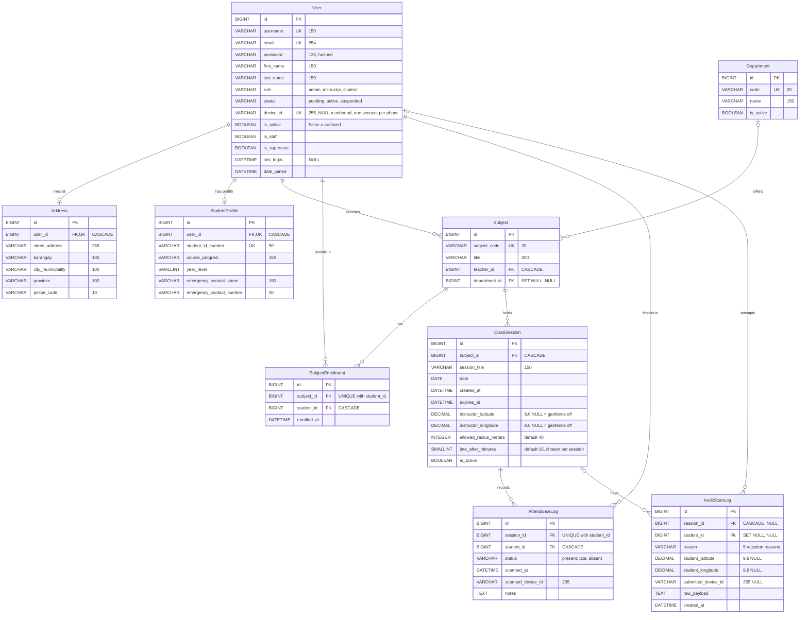

# SmartAttendance ERD

Entity-relationship diagram of the app's 9 tables (generated from `attendance/models.py`).
GitHub and VS Code (with a Mermaid preview extension) draw it automatically. To export a PNG/SVG,
paste the code block into <https://mermaid.live>.

